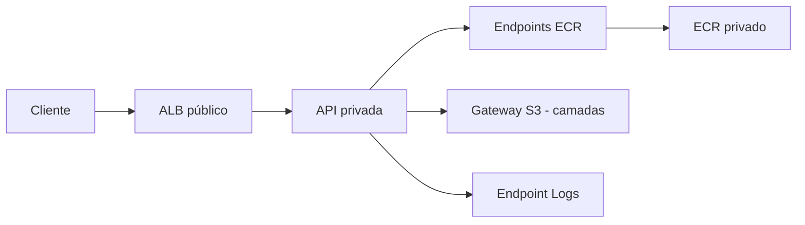

# Case 2 — B — tarefas privadas com endpoints

Status: base Terraform criada; recursos ainda não implementados.

## Decisão

A aplicação usa dependências AWS e não chama parceiros públicos. Tarefas privadas sem rota padrão para NAT/IGW; entrada via ALB público. Há IGW apenas para as subnets públicas do ALB. O endpoint não fornece acesso geral à internet.

| Configuração proposta | dev | hml | prd |
| --- | --- | --- | --- |
| AZs | 2 | 2 | 2 |
| Subnets | Pública e privada por AZ | Pública e privada por AZ | Pública e privada por AZ |
| NAT / IP público nas tarefas | Não | Não | Não |
| Réplicas API | 1 | 1 | 3 |
| Endpoints | Dependências necessárias | Mesmo conjunto base | Mesmo conjunto base |

## Recursos e rotas específicos

Para imagens Linux no ECR privado com Fargate 1.4.0+, criar endpoints de interface ecr.api e ecr.dkr e gateway S3 para camadas de imagem. Criar endpoint logs para awslogs. Associar S3 às tabelas privadas, configurar DNS privado e DNS da VPC, SG de endpoints com HTTPS das tarefas e políticas IAM/endpoints compatíveis.

Secrets Manager e outros endpoints só serão adicionados com dependências correspondentes. O gateway S3 não exige criar bucket de aplicação. Build/push inicial da imagem poderá ocorrer fora da VPC; não pressupor que um runner isolado consiga baixar dependências públicas.

Não há chamada a pagamentos externos neste cenário. Endpoints têm permissões, dependências e possíveis custos; não afirmar segurança absoluta ou tráfego gratuito.

Referência: [AWS: endpoints ECR](https://docs.aws.amazon.com/AmazonECR/latest/userguide/vpc-endpoints.html).

## Base comum e objetivo da entrega

Cliente fictício: Aurora Digital. Os três ambientes (`dev`, `hml`, `prd`) reutilizam a configuração raiz do próprio case, com diferenças em `terraform/tfvars/*.tfvars.example`, sem copiar recursos por ambiente.

O Terraform deverá modelar a infraestrutura do cenário desde a rede: VPC, subnets públicas e privadas, tabelas de rotas e associações, Security Groups, IAM, ALB, ECS Fargate, ECR e CloudWatch. Os componentes de saída variam conforme este documento. O ALB público ocupa subnets públicas; tarefas privadas não recebem IP público.

O ECR será criado pelo exemplo, em vez de pressupor um repositório existente. Criar o repositório não publica uma imagem: build e push serão uma etapa externa claramente documentada. Sem uma imagem disponível, o serviço não poderá iniciar a aplicação.

DNS e HTTPS serão opcionais. O modo inicial por DNS do ALB/HTTP não dependerá de domínio próprio. Quando HTTPS for escolhido, documentar emissão/validação ACM, domínio e delegação DNS; um domínio real não pode ser substituído por example.com em um deploy. Evitar IDs de infraestrutura preexistente como dependência escondida.

O backend remoto precisa existir antes do init que o utiliza. Na implementação, definir bootstrap separado do S3 ou execução com estado local; o backend não poderá depender de um bucket criado pela mesma configuração que exige esse backend na inicialização. Neste case, a configuração começa com estado local; backend S3 exige bootstrap separado.

Configuração completa significa incluir recursos necessários ao cenário e explicitar pré-requisitos externos: conta/autenticação, quotas, região, imagem publicada e domínio se habilitado. Não significa adicionar serviços sem requisito. DynamoDB, RDS, API Gateway e EKS não fazem parte destes três cases inicialmente.

## Segurança e composição

SG do ALB permite as portas publicadas; SG da API permite sua porta somente a partir do SG do ALB. Worker, se configurado, não recebe listener ou Target Group. Separar Execution Role e Task Role. Usar NACL padrão inicialmente, com regras de acesso concentradas nos SGs; NACL personalizada exige inventário de chamada e retorno.

Usar mapas com chaves estáveis e for_each para subnets e serviços; recursos opcionais por parâmetros explícitos. Usar dynamic somente para blocos internos repetíveis. CPU, memória, réplicas, retenção e alarmes serão configuráveis. Estados e identificadores serão separados por ambiente.

## Execução e próximos passos

A base Terraform foi iniciada. O checklist específico está em ../process.log; recursos serão implementados incrementalmente. GitHub Actions, outras escolhas de CI e uma aplicação de teste local serão decididos posteriormente. A aplicação poderá demonstrar testes e build sem executar na AWS; isso não comprova a conectividade da infraestrutura.

Não executar plan, apply, deploy ou acesso ao backend AWS nesta etapa. O objetivo atual é modelar a configuração e executar validação local quando a ferramenta estiver disponível. Somente resultados efetivamente executados serão apresentados como evidência.
